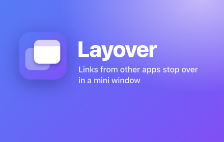
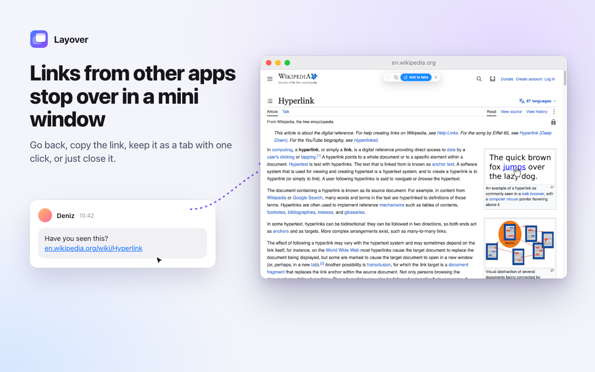
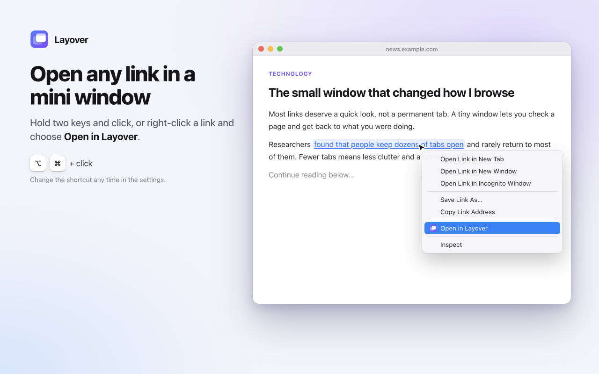
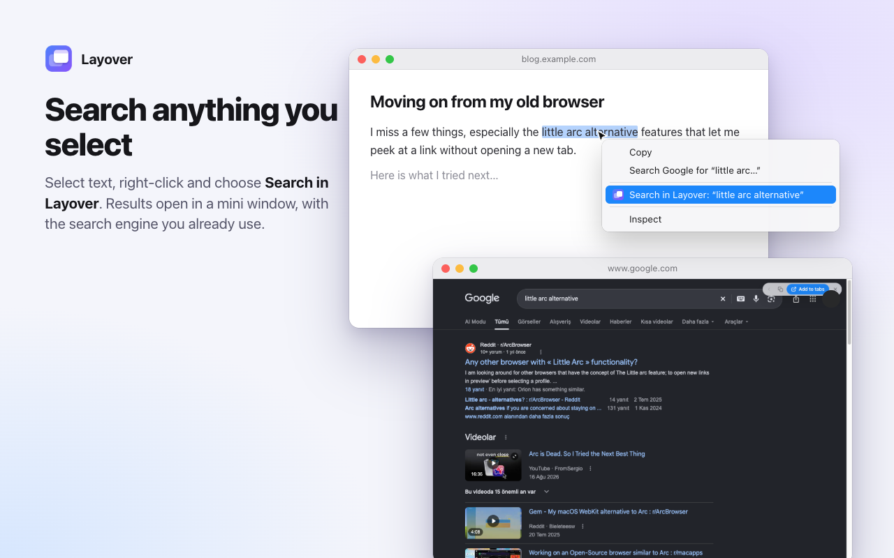
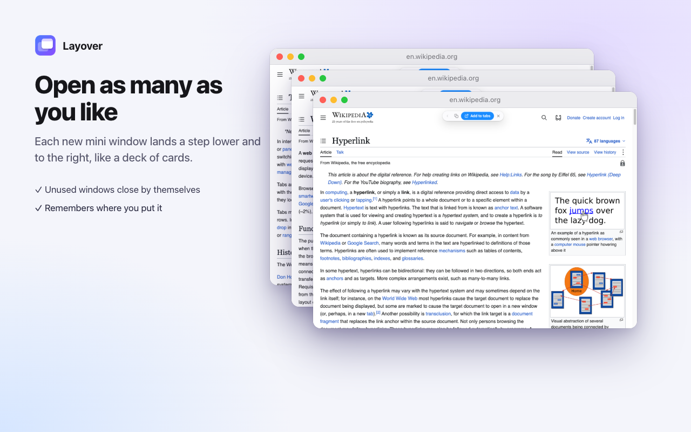
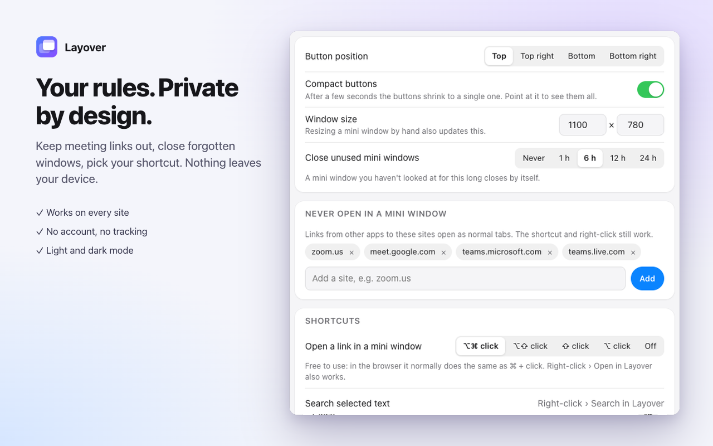

# Layover

<p align="center"></p>

**A mini window for links from other apps.**

When you click a link in Mail, Slack, Messages, Notes or any other app, the browser normally drops it into your main window as yet another tab. Layover catches that link and opens it in a small, temporary popup window instead. Read it, then decide: keep it as a tab with one click, or close it and it's gone.



Layover is a Chrome extension (Manifest V3). It also works in other Chromium browsers such as Edge, Brave, Arc and Vivaldi.

## What it does

- **Links from other apps open in a mini window.** The window appears centred over your main window. Nothing in your tab bar changes.
- **A small floating bar inside the mini window** gives you four actions: go back, copy the link, add the page to your tabs, or close it. After a few seconds it shrinks to a single button and comes back when you point at it. You can turn that off.
- **Add to tabs** moves the page into your main window as it is. No reload, so logins, scroll position and form input stay.
- **Open any link in a mini window** with a modifier + click (⌥⌘ + click on Mac, Ctrl + Alt + click elsewhere) or from the right-click menu.
- **Search selected text** in a mini window, using the search engine your browser already uses.
- **Settings one click away.** Click the Layover icon in the toolbar to open the settings.
- **Keyboard shortcuts** inside a mini window: Alt + Shift + O adds it to your tabs, Alt + Shift + C copies its link, Alt + Shift + W closes it. All three can be changed in `chrome://extensions/shortcuts`. Maximizing a mini window also adds it to your tabs.
- **Remembers where you put it.** The window size is kept, and during a browser session the next mini window opens where you last moved one. If more than one is open, they stack like cards.
- **Never-mini list.** Links to some sites (meeting links by default: Zoom, Google Meet, Teams) always open as normal tabs.
- **Auto-close.** Mini windows you haven't looked at for a while close by themselves. Windows playing sound are left alone.
- **Private windows stay private.** A link or tab from a private window opens in a private mini window, and "add to tabs" puts it back in a private window.
- **Light and dark mode**, reduced-motion support, keyboard-friendly settings.
- **Seven languages:** English, Turkish, German, Spanish, French, Italian and Brazilian Portuguese.

| | |
| --- | --- |
|  |  |
| Open any link with ⌥⌘ + click or the right-click menu | Search selected text with your default search engine |
|  |  |
| Open as many as you like, each one a step lower | Window size, auto-close, never-mini list and shortcuts |

## How it recognises a link from another app

When the operating system hands a URL to the browser, the browser opens a new tab whose first navigation has the `AUTO_TOPLEVEL` transition type. Layover watches for that with the `webNavigation` API. Links clicked inside web pages, typed URLs and bookmarks have other transition types, so they are never affected. Tabs restored at browser launch and the start pages you set in the browser open as usual.

The transition type is only known once the page starts loading, which can take a second on a slow site. To keep the main window from showing in the meantime, Layover acts as soon as the tab appears when the browser was in the background or was just brought forward: a new active tab with a web address and no opener goes straight into a mini window. When the page then reports its transition type, Layover checks it again. If the tab turns out not to come from another app, or it was redirected to a never-mini site, it is moved back to the main window.

### Known limits

- **A link that starts the browser opens as a normal tab.** When the browser is closed and a link from another app launches it, the tab exists before any extension is running, so Layover never sees it. Links that arrive once the browser is open work as usual, even a second after launch.
- **A minimized main window still flashes briefly.** When a link arrives, Chrome itself restores the minimized main window first, and extensions cannot run until that animation ends. Layover opens the mini window right after and minimizes the main window again.
- **Chromium only.** Firefox and Safari report links from other apps differently, so the detection used here does not carry over.

## Privacy

Everything runs on your device. Layover does not collect, store or send your browsing data. It has no analytics, no remote code and no network requests of its own.

The extension needs the `webNavigation` permission and access to all sites to do its job (detecting the incoming link and drawing the floating bar on the page). If you turn on the diagnostics log in the settings, only the host name of each handled link is kept, locally, and the log is deleted when you turn it off.

## Install

### From source

1. Download or clone this repository.
2. Open `chrome://extensions` and turn on **Developer mode**.
3. Click **Load unpacked** and choose the project folder.

### Settings

Click the Layover icon in the toolbar. There you can change the window size, the position of the floating bar, compact buttons, the click shortcut, the auto-close delay and the never-mini list, and try it out with a sample link.

## Development

No build step and no dependencies. Edit the files, then press the reload button for Layover on `chrome://extensions`.

### Tests

`test/run.js` drives a real browser through the Chrome DevTools Protocol and checks 68 scenarios: links from other apps, early pop-out and its undo, the floating bar, add to tabs, shortcuts, placement, auto-close, private windows, browser start and the settings page. It needs Node 22 or newer and Chrome for Testing, because branded Chrome no longer loads unpacked extensions from the command line.

```bash
npx @puppeteer/browsers install chrome@stable
```

```bash
node test/run.js
```

A test browser window opens on screen for about a minute and a half, with its own temporary profile. Set `CHROME` to use a different browser binary. The copy-link test writes to the clipboard and puts text back afterwards.

### Packaging

```bash
node scripts/package.js
```

This builds `dist/layover-<version>.zip` for the Chrome Web Store. It stops with an error if a file referenced by the manifest, the service worker or the settings page is missing, or if a language is missing a string. It also updates the version and size in `store/store-listing.md`.

## Project layout

| File | Purpose |
| --- | --- |
| `manifest.json` | Extension manifest (MV3) |
| `shared.js` | Default settings and helpers shared by the other scripts |
| `background.js` | Service worker: link detection, mini windows, floating bar, shortcuts, context menus, auto-close |
| `content.js` | Modifier + click on links, runs on every page |
| `options.html`, `options.js`, `options.css` | Settings page |
| `_locales/` | Strings in seven languages |
| `icons/` | Extension icons |
| `test/` | End-to-end tests |
| `scripts/package.js` | Builds the store zip |
| `store/` | Store listing, privacy policy and images |

## Support

Layover is free. If it saves you time, you can [buy me a coffee](https://buymeacoffee.com/uygardev). ☕

## License

[MIT](LICENSE)

---

### Türkçe

Layover, diğer uygulamalardan (Mail, Slack, Mesajlar…) gelen linkleri ana pencerenize sekme olarak atmak yerine küçük, geçici bir pencerede açan bir Chrome eklentisidir. Sayfayı okuyun; işinize yararsa tek tıkla sekmelere ekleyin, yaramazsa kapatın. Her şey cihazınızda çalışır, hiçbir veri toplanmaz veya gönderilmez.

Kurulum için `chrome://extensions` sayfasında **Geliştirici modu**'nu açın ve **Paketlenmemiş öğe yükle** ile proje klasörünü seçin. Eklenti Türkçe dahil yedi dilde gelir. Tarayıcı kapalıyken tıklanan link tarayıcıyı başlattığı için normal sekmede açılır; tarayıcı açıldıktan sonra gelen linkler mini pencereye uğrar.

İşinize yarıyorsa [bir kahve ısmarlayabilirsiniz](https://buymeacoffee.com/uygardev).
